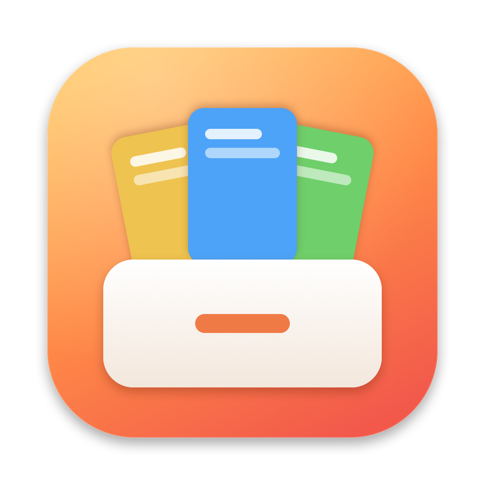

<p align="center"></p>

<h1 align="center">Cubby</h1>

<p align="center">A local-only clipboard history for macOS. Everything you copy, one keystroke away, in a drawer at the edge of your screen.</p>

Cubby lives in your menu bar. Copy anything and it's saved. Press ⇧⌘V and a glass drawer slides in from the right. Pick a clip and press Return, and it's pasted into the app you were using. The drawer never takes focus away from that app.

## Features

- **History**: text, images, links, colours and files, each with every format the source app put on the clipboard. Copying the same thing again moves it to the top instead of making a duplicate.
- **The drawer**: cards sized to their content, grouped by day.
  - Text shows four lines, images show the whole picture, links show the page title and image, files show a Quick Look thumbnail, and colours show a swatch.
  - Hover a card for Pin, Copy and More.
  - Drag a card out into any app.
- **Pinboards**: keep clips forever in named, coloured boards in the drawer's rail. Pin from a card's menu or drag a card onto a board. Rename, recolour, reorder, or drag to sort clips inside a board.
- **Preview**: press Space for a large preview beside the drawer. It follows the selection as you move. Text is scrollable, images show at full size, links open as a live page, files use Quick Look.
- **Search**: start typing anywhere in the drawer. Words like "link", "image" or an app name become filter chips. The filter tray (⌘F) narrows by type, app and date.
- **Link Cleaner**: copied links lose their tracking (`utm_*`, `fbclid`, YouTube's `si`, Amazon's `ref=` and more) before you paste them anywhere. The card says how many trackers went; **Paste Original Link** is one right-click away.
- **Merge Clips**: select several cards and press ⌘M to combine them into one clip: lines, a bullet list, comma-separated or one paragraph.
- **Pinboards that follow apps**: tie a board to an app and the drawer opens on it there, e.g. your shell snippets in Terminal and your canned replies in Slack.
- **Self-destructing secrets**: API keys, private keys, tokens, card numbers and one-time codes are blurred in the drawer (hover or hold ⌥ to see them) and deleted after 10 minutes unless you pin them, clipboard included.
- **Undo**: deleting clips, unpinning and deleting a pinboard can all be undone with ⌘Z.
- **Privacy**: passwords and other concealed or temporary copies are skipped. You can ignore whole apps, pause capture, and hide the drawer during screen sharing.
- **Settings**: open at login, paste into the app or to the clipboard only, always paste as plain text, history length (a day to forever), and a recordable shortcut.

Everything stays on your Mac. The only network requests are optional link previews (page title and image), which you can turn off.

## Shortcuts

| Action | Shortcut |
|---|---|
| Open the drawer | ⇧⌘V (change it in Settings → Shortcuts) |
| Paste / paste as plain text | ↩ / ⇧↩ |
| Quick paste the first nine | ⌘1 – ⌘9 |
| Preview | Space |
| Copy | ⌘C |
| Merge selected clips | ⌘M |
| Delete / Undo | ⌫ / ⌘Z |
| Next / previous list | ⇥ / ⇧⇥ or ⌘→ / ⌘← |
| Filters | ⌘F |
| New pinboard | ⇧⌘N |
| New text clip | ⌘N |

## Install

Download the latest `Cubby-<version>.dmg` from [Releases](../../releases) and drag Cubby to Applications.

Releases are signed with a Developer ID and notarized by Apple, so they open like any other app.
To paste straight into the app you were using, Cubby needs **Accessibility** permission. Without it, Return copies the clip and you press ⌘V yourself.

Requires macOS 14 or later.

## Build from source

You only need the Xcode Command Line Tools; full Xcode isn't required.

```bash
./build.sh        # builds build/Cubby.app
./build.sh run    # builds and relaunches it
./build.sh release  # Developer ID-signed, notarized and stapled build/Cubby-<version>.dmg
build/Cubby.app/Contents/MacOS/Cubby --self-test
```

`build.sh release` needs a "Developer ID Application" certificate in your keychain and a notarytool profile named `notary`, saved once with `xcrun notarytool store-credentials notary --key AuthKey_<id>.p8 --key-id <id> --issuer <issuer id>`.

`build.sh` signs with your first "Apple Development" identity when you have one. A stable signature keeps the Accessibility permission across rebuilds; without one, it signs ad hoc.

Pushing a `v*` tag runs the **Build DMG** workflow, which signs, notarizes and attaches `Cubby-<version>.dmg` to a GitHub release. It needs the repository secrets `DEVELOPER_ID_P12`, `DEVELOPER_ID_P12_PASSWORD`, `NOTARY_KEY_P8`, `NOTARY_KEY_ID` and `NOTARY_ISSUER_ID`. Pushes to `main` build an unsigned test DMG.

## Project layout

```
Sources/Cubby/
  App/       menu bar app, hotkeys, settings (+ window), menu bar icon, self-test
  Capture/   clipboard watcher, classifier (kind, checksum, previews), pasteboard writer
  Store/     SQLite + FTS5 store, blob files, models
  Panel/     the drawer, cards, preview, filter tray, toasts
Resources/   Info.plist, app icon (+ make-icon.swift that renders it)
```

Clips live in `~/Library/Application Support/Cubby/`: `store.sqlite` holds the rows, card previews and search index, and `blobs/` holds each clip's full clipboard data, compressed with LZFSE.

## Contributing

Issues and pull requests are welcome. Keep changes small and focused. Run `--self-test` before you open a pull request, and include a screenshot for UI changes.

## License

Copyright (C) 2026 Heet Patel

Cubby is free software: you can redistribute it and/or modify it under the terms of the GNU General Public License as published by the Free Software Foundation, either version 3 of the License, or (at your option) any later version.

Cubby is distributed in the hope that it will be useful, but WITHOUT ANY WARRANTY; without even the implied warranty of MERCHANTABILITY or FITNESS FOR A PARTICULAR PURPOSE. See the [GNU General Public License](LICENSE) for more details.
